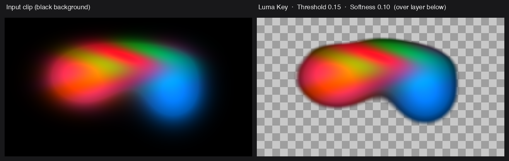

# Resolume Luma Keyer user guide

Luma Key is a luminance keyer for [Resolume](https://resolume.com) Arena and Avenue, as an FFGL
effect. It measures the perceptual (Rec. 709) luminance of each pixel and drives that pixel's
alpha from it, so dark areas of a clip go transparent and let the layers below show through.

It's the quick way to key out a black background, tame add-blend-style content, or pull a shadow
or highlight matte, without needing a dedicated key colour.

> **Status:** released at v1.3.6, and it's been **run inside Resolume on real content**. It needs
> Resolume Arena or Avenue **7.3.1 or newer**. The same key now also builds for OpenFX hosts and
> for After Effects and Premiere Pro; see below for where each one goes. The before/after image
> below is rendered with the plugin's own shader maths rather than captured from Resolume.

---

## Installing

Drop the plugin into Resolume's plugin folder and restart it:

```
macOS    ~/Documents/Resolume Arena/Extra Effects/
Windows  %USERPROFILE%\Documents\Resolume Arena\Extra Effects\
```

Avenue uses the same layout under its own folder name. It shows up in the effects list as
**SW Luma Key**.

There's also a **macOS disk image** and a **Windows installer** in the release, which put the
plugin where the host looks without you copying anything.

**The macOS builds are Developer ID-signed and notarised** (FFGL, OpenFX and Adobe alike), so
there's nothing to clear and no `xattr` step. **The Windows builds aren't code-signed.** Plugin
files aren't gated the way `.exe` files are, so a host loads them normally; it's only the
*installer* that trips SmartScreen, once: **More info** → **Run anyway**. Checksums and the
per-artefact detail are in [UNSIGNED.md](UNSIGNED.md).

### After Effects and Premiere Pro — beta

The same key builds as an After Effects plugin, which Premiere Pro loads too. Take the
`luma-key-adobe-*` zip for your platform and copy the plugin into the shared Adobe folder, then
restart the host:

```
macOS    /Library/Application Support/Adobe/Common/Plug-ins/7.0/MediaCore/   (LumaKey.plugin)
Windows  C:\Program Files\Adobe\Common\Plug-ins\7.0\MediaCore\            (LumaKey.aex)
```

That folder is root-owned on macOS, so the copy needs an administrator password. The effect
shows up under **Effects → Stoatworks → Luma Key**.

It's called beta because it's the newest of the builds, not because the maths differs: the key
is the same and the bundle is verified, it's just had less time in real hosts than the FFGL
and OpenFX builds have. One thing worth knowing if a result looks inverted in the two hosts:
Premiere's legacy render path hands over pixels as BGRA where After Effects uses ARGB, and the
plugin swaps its luminance weights to match, so the two agree.

### OpenFX hosts (Resolve, Vegas, Nuke, Natron)

Luma Key also ships as an OpenFX plugin, with the same effect and the same controls. Copy
`LumaKey.ofx.bundle` from the `-ofx-` download into the OpenFX folder and
restart the host:

```
macOS    /Library/OFX/Plugins/
Windows  C:\Program Files\Common Files\OFX\Plugins\
Linux    /usr/OFX/Plugins/
```

---

## The two controls



*Threshold 0.15, Softness 0.10: the defaults.*

| Parameter | Default | What it does |
|---|---|---|
| **Threshold** | 0.15 | The luma level at the **centre** of the key edge. Pixels darker than this are keyed out. |
| **Softness** | 0.10 | The **width** of the soft edge around that threshold. `0` is a hard cut; higher is a gradual falloff. |
| **Invert** | Off | Flips the key so **bright** pixels are removed instead of dark ones. |

The one thing to remember: **Threshold is the middle of the ramp, not its start.** Raising
Softness widens the transition *around* the threshold in both directions, so a high Softness with
a low Threshold will start eating into the midtones. If a key's biting too far, lower Softness before
you touch Threshold.

---

## Getting a clean key

1. **Set Softness to 0 first.** A hard cut shows you exactly where the threshold is landing;
   softness only hides that while you're still deciding.
2. **Raise Threshold until the background is gone** and no further. Watch the darkest parts of the
   subject you want to *keep*; they go next.
3. **Then add Softness**, just enough to lose the stair-stepping on the edge.

For a highlight matte, turn **Invert** on and repeat: the same procedure, working down from white.

---

## How it composites

The effect works on **straight (unpremultiplied) colour internally** and outputs **premultiplied
colour clamped to the LDR range**, matching Resolume's own pipeline, so it composites cleanly
with the layers beneath it rather than leaving dark or bright fringes on the soft edge.

That's why it behaves properly on the *soft* part of the key and not just the hard part, which
is where a naive luma key usually falls over.

---

## What it is not

- **Not a chroma keyer.** There's no key colour; it only looks at luminance. A green screen
  needs a chroma keyer.
- **Not a spill suppressor.** It changes alpha, not colour.
- **Not a garbage matte.** Every pixel is judged on its own luminance, with no idea what's next to
  it: a bright object against a black background keys well, and a bright object against a bright
  background doesn't key at all.

---

## Audio reactivity

Both controls are plain floats, so Resolume can drive them from its own audio analysis: the
dropdown beside the parameter, then **FFT**, a band and a gain.

**Threshold** on the low band is a handy trick: the key *opens with the music*, so a
bright graphic over a clip appears on the hits and sinks back between them. Set Threshold so the
graphic is only just keyed out at silence, and let the FFT push it over. A little **Softness**
keeps the arrival from strobing.

---

## Troubleshooting

| Symptom | Cause |
|---|---|
| **Plugin doesn't appear in Resolume** | Wrong folder, or Resolume older than 7.3.1. On macOS, check quarantine on the bundle itself. |
| **Key eats into the subject** | Threshold is the centre of the ramp — lower Softness before lowering Threshold. |
| **Edges are stair-stepped** | Softness is at or near 0. |
| **Dark fringe on the soft edge** | Shouldn't happen — the output is premultiplied to match Resolume. Worth reporting. |
| **Nothing keys at all** | The background may not be dark. Try **Invert**, or check the clip actually has the luma range you think. |
| **Keyed the wrong end of the range** | That is what **Invert** is for. |

---

## See also

- [README](../README.md): parameters, build instructions and downloads
- [UNSIGNED.md](UNSIGNED.md): Gatekeeper and SmartScreen
